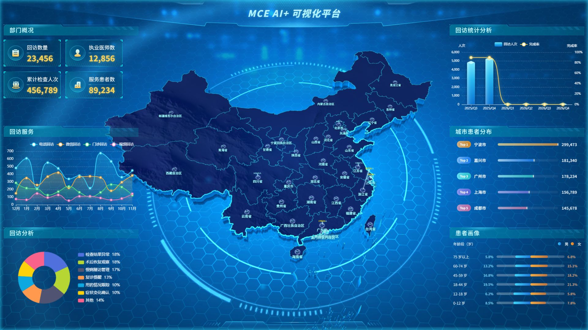
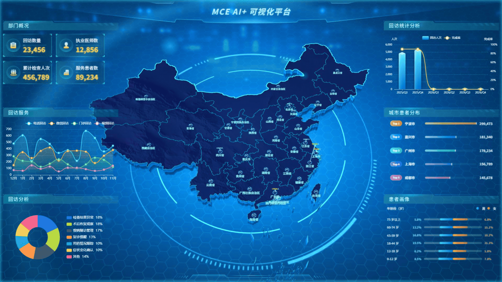

# A4CA Screen

[简体中文](README.md) | [English](README.en.md)

### Bring healthcare data to life on a 3D dashboard

A healthcare data visualization dashboard built with **Vue 3, Three.js and Apache ECharts**. A 3D map of China sits at the center of a large-screen display, surrounded by service trends, geographic distribution and patient demographics. Explore a working front-end example for WebGL maps, data dashboards and digital twin visualization interfaces.

   

## Preview

### Dashboard screenshot



### Animated preview



[View the original GIF](docs/media/demo.gif) · [Download the demo recording (1080p, approximately 9 fps)](docs/media/demo-capture.mp4)

## About

This project was created by referencing and recreating the visual style of Neusoft Medical's Xikang dashboard. It has received awards in multiple university competitions. This front-end implementation is shared for learning and exchange; it is not an official Neusoft Medical product.

The dashboard combines a WebGL scene, map outlines, extruded terrain, lighting effects, charts and data cards on a 1920 × 1080 canvas. It is intended as a starting point for developers interested in **3D maps, healthcare dashboards and digital twin interfaces**.

## Features

- **3D map**: China map, regional boundaries, extruded geometry, terrain textures and geographic labels.
- **Animated visuals**: particles, rings, map lighting and scene animation.
- **Healthcare panels**: department overview, follow-up service trends and analysis, follow-up statistics, city patient rankings and patient demographics.
- **Combined visualization stack**: Three.js for the 3D scene, ECharts for charts and Vue components for the interface.
- **Large-screen scaling**: designed around a 1920 × 1080 canvas and scaled to the browser window.

> The current dashboard uses bundled mock data for demonstration; it does not represent real healthcare data. API wrappers are included, but connecting a real service requires adapting the application to your backend.

## Getting started

Install Node.js and npm. Node.js 18 or 20 is recommended for Vite 4.

```bash
npm install
npm run dev
```

Open the URL printed in the terminal, normally `http://localhost:8088/a4ca/`, in a modern browser with WebGL support.

```bash
npm run build     # Build for production
npm run preview   # Preview the production build
```

The Vite base path is currently `/a4ca/`. Change `base` in `vite.config.js` when deploying at another path. The development proxy forwards `/api` to `http://localhost:9090`; set `VITE_API_BASE_URL` for the production API address. Components currently read `src/api/mockData.js` by default, so configuring the API address alone does not switch them to live data.

## Project structure

```text
src/
├── api/                 # API wrappers and mock data
├── assets/              # Textures and dashboard assets
├── components/charts/   # Dashboard panels and charts
├── mini3d/              # Three.js helpers and components
├── utils/               # Screen scaling and utilities
└── views/map-animate/   # Map scene and animation
public/                  # Geographic data and Draco decoders
docs/media/              # Screenshots, animation and recording
```

## Keywords

Healthcare data visualization · Medical dashboard · 3D data visualization · China map visualization · Three.js map · Vue dashboard · ECharts dashboard · WebGL · Digital twin visualization · Large-screen dashboard · Data cockpit · Smart healthcare

## Contributing

Issues and contributions are welcome. Share your use case, report a problem or propose an improvement. If the project helps your visualization work, consider giving it a star.

## Credits and license

Thanks to Vue, Three.js, Apache ECharts, DataV, GSAP and their contributors. `public/draco/` includes third-party Draco resources; see its README for details. Rights to referenced designs and third-party assets belong to their respective owners; check applicable permissions before reuse or redistribution.

Project code is released under the [MIT License](LICENSE). Third-party dependencies and assets remain subject to their own licenses.
