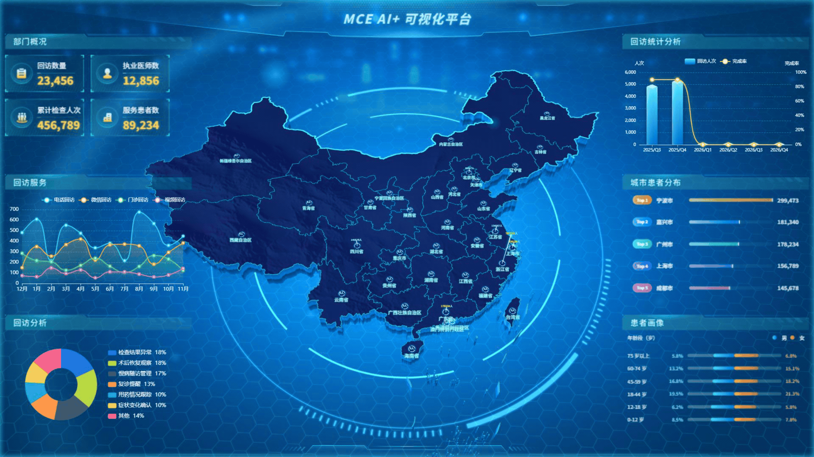

# A4CA Screen

### 让医疗数据跃然于三维大屏之上

一个基于 **Vue 3 + Three.js + ECharts** 的医疗数据可视化大屏。以立体中国地图为视觉中心，将地域分布、服务趋势与患者画像汇聚到同一画面，为数据大屏、Web 3D 和数字孪生可视化提供可运行的前端参考。

   



[查看完整大屏截图](docs/media/screenshot.jpg) · [下载演示录像（1080p，约 9 fps）](docs/media/demo-capture.mp4)

## 项目介绍

本项目参考并模仿东软医疗熙康大屏制作，以高度还原其视觉呈现为目标。项目曾在多个高校比赛中获奖。这里分享的是面向学习和交流的可视化前端实现，并非东软医疗官方产品。

从地图轮廓、立体地形和光效，到两侧图表和数据卡片，项目将 WebGL 场景与常规数据图表组合在一块 1920 × 1080 的大屏上。适合希望探索 **Three.js 地图、医疗数据可视化、数字孪生展示界面** 的开发者阅读和实践。

## 功能亮点

- **三维地图场景**：中国地图、区域边界、立体挤出、地形纹理和地域标签。
- **动态视觉效果**：粒子、光环、地图光效与场景动画，营造大屏空间感。
- **医疗数据面板**：部门概况、回访服务趋势、回访分析、回访统计、城市患者分布和患者画像。
- **组合式技术栈**：Three.js 负责地图场景，ECharts 负责图表，Vue 组件组织界面。
- **大屏适配**：以 1920 × 1080 为设计基准，根据窗口尺寸缩放。

> 当前页面使用项目内置的模拟数据，仅用于界面演示，不代表真实医疗业务数据。代码中保留了后端 API 封装；接入真实服务需要根据实际接口调整。

## 快速开始

需要 Node.js 和 npm。推荐使用与 Vite 4 兼容的 Node.js 18 或 20。

```bash
npm install
npm run dev
```

在浏览器访问终端输出的地址，默认是 `http://localhost:8088/a4ca/`。需要支持 WebGL 的现代浏览器。

```bash
npm run build     # 生产构建
npm run preview   # 预览构建结果
```

Vite 的部署基础路径目前配置为 `/a4ca/`。部署到其他子路径或网站根目录时，请修改 `vite.config.js` 的 `base`。开发代理将 `/api` 转发至 `http://localhost:9090`；生产环境可通过 `VITE_API_BASE_URL` 配置接口地址。当前组件默认读取 `src/api/mockData.js`，仅设置接口地址不会自动切换到真实数据。

## 项目结构

```text
src/
├── api/                 # 接口封装与模拟数据
├── assets/              # 纹理、大屏背景等资源
├── components/charts/   # 六组图表和数据面板
├── mini3d/              # Three.js 场景基础工具与组件
├── utils/               # 大屏适配和工具函数
└── views/map-animate/   # 地图场景与动画
public/                  # 地图数据及 Draco 解码资源
docs/media/              # 项目展示素材
```

## 参与交流

欢迎通过 Issue 分享使用场景、提出问题或建议，也欢迎提交改进。若这个项目对你的数据可视化实践有所帮助，欢迎点一个 Star，让更多开发者发现它。

## 致谢与素材说明

感谢 Vue、Three.js、Apache ECharts、DataV、GSAP 等开源项目及其贡献者。`public/draco/` 包含第三方 Draco 资源，具体说明见该目录的 README。项目参考的界面及可能涉及的第三方素材，其权利归相应权利人所有；使用和再分发前请核实相关授权。

项目代码以 [MIT License](LICENSE) 发布；第三方依赖和资源适用各自的许可条款。
